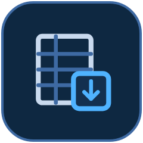

[My Portfolio](https://github.com/courtney-chapman/portfolio-public) shows the projects and demonstrations behind related tools. [Visual portfolio](https://courtneypetersonchapman.notion.site/) presents the same work in Notion.

**Project status:** These tools are independent demonstrations provided as-is, not managed services. They are not guaranteed to reflect subsequent regulatory changes. Users are responsible for verifying applicable requirements, source currency and outputs before operational use.

**Start here:** [Browser apps](#standalone-browser-apps) · [Plugins](#plugins) · [Releases](https://github.com/courtney-chapman/tools-public/releases)

## Get a plugin

- **Codex desktop or CLI:** Add this repository as a marketplace with `codex plugin marketplace add courtney-chapman/tools-public`, then browse and install the plugin you want.
- **ChatGPT web with ZIP upload access:** Download one plugin ZIP from [Releases](https://github.com/courtney-chapman/tools-public/releases), then use the plugin upload option in your account. Upload availability depends on your plan and permissions.

Each ZIP contains one plugin and the repository license. The plugin folders below remain the source for future releases.

## Standalone browser apps

These offline browser apps are separate from the Codex plugins.

| App | Description and links |
| --- | --- |
|  **DD Form 1149 Generator** | Prepare a DD1149-style shipping document and continuation sheets locally in your browser. [Download](https://github.com/courtney-chapman/tools-public/releases/tag/dd1149-generator-v1.0.1) · [Guide](apps/dd1149-generator/README.md) |
|  **Government Property Record Template Generator** | Create related property snapshot and transaction-history CSV templates, explore synthetic examples, and review selected CSV files locally. [Download](https://github.com/courtney-chapman/tools-public/releases/tag/government-property-record-template-generator-v1.0.0) · [Guide](apps/government-property-record-template-generator/README.md) · [Sources](apps/government-property-record-template-generator/docs/sources.md) |
|  **Physical Inventory Count Sheet Generator** | Prepare standard or blind count sheets from a working property list, enter observations, and export results and discrepancies. [Download](https://github.com/courtney-chapman/tools-public/releases/tag/physical-inventory-count-sheet-generator-v1.0.0) · [Guide](apps/physical-inventory-count-sheet-generator/README.md) · [Sources](apps/physical-inventory-count-sheet-generator/docs/sources.md) |
|  **Government Property Custody Receipt Generator** | Prepare printable property issuance receipts, property return receipts, and custody acknowledgments with multiple item lines. [Download](https://github.com/courtney-chapman/tools-public/releases/tag/property-custody-receipt-generator-v1.0.0) · [Guide](apps/property-custody-receipt-generator/README.md) · [Sources](apps/property-custody-receipt-generator/docs/sources.md) |

## Plugins

### Procurement

| Plugin | Description and links |
| --- | --- |
|  **Procurement Market Research** | Supports federal-prime-contractor market research for commercial products and services, including supplier discovery, public pricing, procurement evidence, and vendor diligence. [Instructions](plugins/procurement-market-research/skills/procurement-market-research/SKILL.md) |
|  **FAR-Compliant Commercial Item Determination** | Evaluates products, software, SaaS, services, and mixed acquisitions for commercial product, commercial service, and COTS treatment under FAR 2.101 and produces buyer guidance or procurement-file-ready determinations. [Instructions](plugins/far-compliant-commercial-item-determination/skills/far-compliant-commercial-item-determination/SKILL.md) |
|  **FAR-Compliant Non-Competitive Source Justification** | Helps federal-prime-contractor Program Managers draft post-market-research sole-source and noncompetitive justifications, including alternate-supplier disqualification language and targeted fields for missing supporting details. [Instructions](plugins/far-compliant-non-competitive-source-justification/skills/far-compliant-non-competitive-source-justification/SKILL.md) |
|  **FAR-Compliant Price Analysis for Goods** | Drafts procurement-file-ready price analysis justifications for government-funded FFP goods, COTS, commercial products, software, materials, and routine buys using the buyer's supplied rules and evidence for competition, market pricing, and best value. [Instructions](plugins/far-compliant-price-analysis-for-goods/skills/far-compliant-price-analysis-for-goods/SKILL.md) |
|  **FAR-Compliant Price Analysis for Subcontracts (Lite)** | Drafts BID SUMMARY & PRICE ANALYSIS write-ups for new subcontract awards, option exercises, and modifications. [Instructions](plugins/far-compliant-price-analysis-for-subcontracts-lite/skills/far-compliant-price-analysis-for-subcontracts-lite/SKILL.md) |
|  **Commercial and Indirect Price Analysis (Lite)** | Drafts concise price analyses for a company's Commercial and Indirect purchases, including services, SaaS, software, consulting, equipment, and routine supplier buys. [Instructions](plugins/indirect-and-commercial-price-analysis-for-services-lite/skills/indirect-and-commercial-price-analysis-for-services-lite/SKILL.md) |
|  **Software/SaaS Negotiation Strategy** | Guides federal procurement professionals through internal discovery, vendor questions, negotiation strategy, and optional practice for SaaS acquisitions under the Simplified Acquisition Threshold. [Instructions](plugins/software-saas-negotiation-strategy/skills/software-saas-negotiation-strategy/SKILL.md) |

### Government property

| Plugin | Description and links |
| --- | --- |
|  **Government Property LTDD Relief Letter Generator** | Generates and validates audit-defensive Government Property LTDD relief packages while preserving the distinction between verified facts, interview statements, assumptions, and missing evidence. [Instructions](plugins/government-property-ltdd-relief-letter-generator/skills/government-property-ltdd-relief-letter-generator/SKILL.md) |

## Repository layout

- `plugins/` contains the public Codex plugin packages.
- `apps/dd1149-generator/` contains the standalone browser app.
- `apps/government-property-record-template-generator/` contains the offline property template app.
- `apps/physical-inventory-count-sheet-generator/` contains the offline physical inventory app.
- `apps/property-custody-receipt-generator/` contains the offline custody receipt app.
- `.agents/plugins/marketplace.json` publishes the repository's plugin catalog.
- `docs/` contains README graphics and release images.
- `support/` contains repository validation guidance.

## Repository guide

- See [repository support](support/README.md) for development and validation.

Nothing committed here may depend on private content, secrets, or paid APIs.
New examples should be synthetic or sanitized, and credentials, secrets,
private case material, and personal information must never be committed.
Private review evidence does not belong in this repository.

## Release and licensing

Security concerns should follow the [security policy](SECURITY.md).

Original repository content is licensed under [CC BY-NC 4.0](LICENSE), **except**
`apps/dd1149-generator/`, `apps/government-property-record-template-generator/`, `apps/physical-inventory-count-sheet-generator/`, and `apps/property-custody-receipt-generator/`, each licensed under its own MIT license ([DD1149](apps/dd1149-generator/LICENSE); [property templates](apps/government-property-record-template-generator/LICENSE); [physical inventory](apps/physical-inventory-count-sheet-generator/LICENSE); [custody receipt](apps/property-custody-receipt-generator/LICENSE)).
Third-party material remains subject to its own terms.
