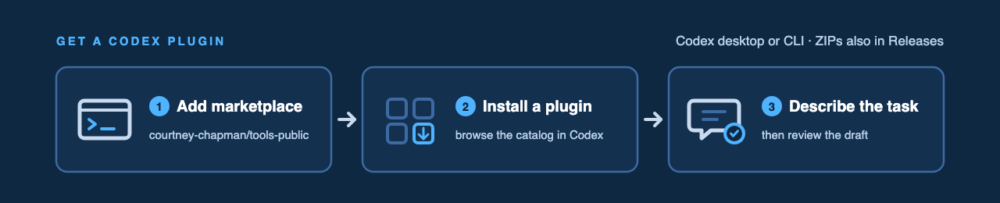

[My Portfolio](https://github.com/courtney-chapman/portfolio-public) shows the projects and demonstrations behind related tools. [Visual portfolio](https://courtneypetersonchapman.notion.site/) presents the same work in Notion.

**Project status:** These tools are independent demonstrations provided as-is, not managed services. They are not guaranteed to reflect subsequent regulatory changes. Users are responsible for verifying applicable requirements, source currency and outputs before operational use.

**Start here:** [Browser apps](#standalone-browser-apps) · [Plugins](#plugins) · [Releases](https://github.com/courtney-chapman/tools-public/releases)

## Standalone browser apps

| &nbsp;&nbsp;&nbsp;&nbsp;&nbsp;&nbsp;&nbsp;&nbsp;&nbsp;&nbsp;&nbsp;&nbsp;&nbsp;&nbsp; |  |
| --- | --- |
|  | **DD Form 1149 Generator** Create DD Form 1149-style shipping documents and continuation sheets offline. [Download](https://github.com/courtney-chapman/tools-public/releases/tag/dd1149-generator-v1.0.1) · [Guide](apps/dd1149-generator/README.md) |
|  | **Government Property Record Template Generator** Create property snapshot and transaction-history CSV templates and review files offline. [Download](https://github.com/courtney-chapman/tools-public/releases/tag/government-property-record-template-generator-v1.0.0) · [Guide](apps/government-property-record-template-generator/README.md) · [Sources](apps/government-property-record-template-generator/docs/sources.md) |
|  | **Physical Inventory Count Sheet Generator** Create standard or blind count sheets, record observations, and export discrepancies. [Download](https://github.com/courtney-chapman/tools-public/releases/tag/physical-inventory-count-sheet-generator-v1.0.0) · [Guide](apps/physical-inventory-count-sheet-generator/README.md) · [Sources](apps/physical-inventory-count-sheet-generator/docs/sources.md) |
|  | **Government Property Custody Receipt Generator** Create printable property issuance, return, and custody acknowledgment receipts. [Download](https://github.com/courtney-chapman/tools-public/releases/tag/property-custody-receipt-generator-v1.0.0) · [Guide](apps/property-custody-receipt-generator/README.md) · [Sources](apps/property-custody-receipt-generator/docs/sources.md) |

## Plugins

### Get a plugin

- **Codex desktop or CLI:** Add this repository as a marketplace with `codex plugin marketplace add courtney-chapman/tools-public`, then browse and install the plugin you want.
- **ChatGPT web with ZIP upload access:** Download one plugin ZIP from [Releases](https://github.com/courtney-chapman/tools-public/releases), then use the plugin upload option in your account. Upload availability depends on your plan and permissions.

Each ZIP contains one plugin and the repository license. The plugin folders below remain the source for future releases.

### Procurement

| &nbsp;&nbsp;&nbsp;&nbsp;&nbsp;&nbsp;&nbsp;&nbsp;&nbsp;&nbsp;&nbsp;&nbsp;&nbsp;&nbsp; |  |
| --- | --- |
|  | **Procurement Market Research** Find suppliers, public pricing, and evidence for federal prime-contractor market research. [Release](https://github.com/courtney-chapman/tools-public/releases/tag/v2026.11.14.1) · [Source](https://github.com/courtney-chapman/tools-public/tree/main/plugins/procurement-market-research) |
|  | **FAR-Compliant Commercial Item Determination** Assess commercial product, service, and COTS status under FAR 2.101. [Release](https://github.com/courtney-chapman/tools-public/releases/tag/v2026.11.14.1) · [Source](https://github.com/courtney-chapman/tools-public/tree/main/plugins/far-compliant-commercial-item-determination) |
|  | **FAR-Compliant Non-Competitive Source Justification** Draft sole-source and noncompetitive justifications after market research, including alternate-supplier rationale. [Release](https://github.com/courtney-chapman/tools-public/releases/tag/v2026.11.14.1) · [Source](https://github.com/courtney-chapman/tools-public/tree/main/plugins/far-compliant-non-competitive-source-justification) |
|  | **FAR-Compliant Price Analysis for Goods** Draft price analyses for government-funded goods using competition and market evidence. [Release](https://github.com/courtney-chapman/tools-public/releases/tag/v2026.11.14.1) · [Source](https://github.com/courtney-chapman/tools-public/tree/main/plugins/far-compliant-price-analysis-for-goods) |
|  | **FAR-Compliant Price Analysis for Subcontracts (Lite)** Draft subcontract bid summaries and price analyses for awards, options, and modifications. [Release](https://github.com/courtney-chapman/tools-public/releases/tag/v2026.11.14.1) · [Source](https://github.com/courtney-chapman/tools-public/tree/main/plugins/far-compliant-price-analysis-for-subcontracts-lite) |
|  | **Commercial and Indirect Price Analysis (Lite)** Draft price analyses for commercial and indirect purchases using company policy and price evidence. [Release](https://github.com/courtney-chapman/tools-public/releases/tag/v2026.11.14.1) · [Source](https://github.com/courtney-chapman/tools-public/tree/main/plugins/indirect-and-commercial-price-analysis-for-services-lite) |
|  | **Software/SaaS Negotiation Strategy** Build discovery questions and negotiation plans for SaaS buys under the Simplified Acquisition Threshold. [Release](https://github.com/courtney-chapman/tools-public/releases/tag/v2026.11.14.1) · [Source](https://github.com/courtney-chapman/tools-public/tree/main/plugins/software-saas-negotiation-strategy) |

### Government property

| &nbsp;&nbsp;&nbsp;&nbsp;&nbsp;&nbsp;&nbsp;&nbsp;&nbsp;&nbsp;&nbsp;&nbsp;&nbsp;&nbsp; |  |
| --- | --- |
|  | **Government Property LTDD Relief Letter Generator** Draft and review LTDD relief packages, separating verified facts from assumptions and evidence gaps. [Release](https://github.com/courtney-chapman/tools-public/releases/tag/v2026.11.14.1) · [Source](https://github.com/courtney-chapman/tools-public/tree/main/plugins/government-property-ltdd-relief-letter-generator) |

## Licensing and security

Security concerns should follow the [security policy](SECURITY.md).

Original repository content is licensed under [CC BY-NC 4.0](LICENSE). The standalone browser apps have separate MIT licenses in their [app folders](apps/). Third-party material remains subject to its own terms.
