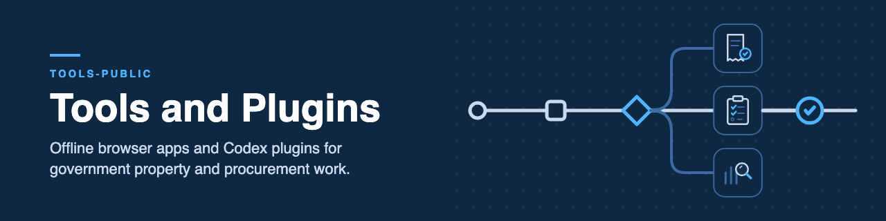
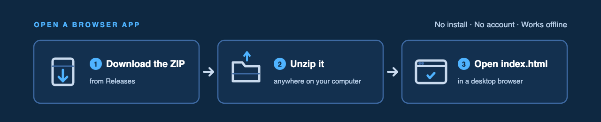
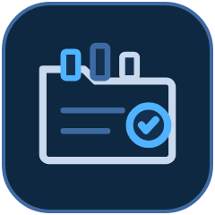

**Start here:** [Browser apps](#standalone-browser-apps) · [Plugins](#plugins) · [Releases](https://github.com/courtney-chapman/tools-public/releases)

> **Project status:** These tools are independent demonstrations provided as-is, not managed services. They are not guaranteed to reflect subsequent regulatory changes. Users are responsible for verifying applicable requirements, source currency and outputs before operational use.

## Standalone browser apps

Try an app online, or download its ZIP from Releases to use it offline. The online versions are hosted with GitHub Pages.



### Procurement

<table width="100%">
  <thead><tr><th width="80">&nbsp;</th><th>&nbsp;</th></tr></thead>
  <tbody>
    <tr><td></td><td><strong>Noncompetitive Source Justification</strong><br>Prepare a factual four-section justification for Procurement review in an offline browser app.<br><a href="https://courtney-chapman.github.io/tools-public/apps/noncompetitive-source-justification/">Try online</a> · <a href="https://github.com/courtney-chapman/tools-public/releases/tag/noncompetitive-source-justification-v1.0.0">Download</a> · <a href="apps/noncompetitive-source-justification/README.md">Guide</a></td></tr>
    <tr><td></td><td><strong>Subcontract Negotiation Memorandum</strong><br>Prepare, document, and review a subcontract negotiation record offline.<br><a href="https://courtney-chapman.github.io/tools-public/apps/subcontract-negotiation-memo/">Try online</a> · <a href="https://github.com/courtney-chapman/tools-public/releases/tag/subcontract-negotiation-memo-v1.1.0">Download</a> · <a href="apps/subcontract-negotiation-memo/README.md">Guide</a></td></tr>
    <tr><td></td><td><strong>Commercial Product, Service, and COTS Determination</strong><br>Organize sources, answer the applicable commercial definition and COTS questions, and prepare a buyer determination offline.<br><a href="https://courtney-chapman.github.io/tools-public/apps/commercial-item-determination/">Try online</a> · <a href="https://github.com/courtney-chapman/tools-public/releases/tag/commercial-item-determination-v1.0.0">Download</a> · <a href="apps/commercial-item-determination/README.md">Guide</a></td></tr>
    <tr><td></td><td><strong>Individual Subcontracting Plan Builder</strong><br>Prepare period goals, worksheets, and an individual small business subcontracting plan for review offline.<br><a href="https://courtney-chapman.github.io/tools-public/apps/individual-subcontracting-plan-builder/">Try online</a> · <a href="https://github.com/courtney-chapman/tools-public/releases/tag/individual-subcontracting-plan-builder-v1.0.0">Download</a> · <a href="apps/individual-subcontracting-plan-builder/README.md">Guide</a></td></tr>
  </tbody>
</table>

### Government property

| &nbsp;&nbsp;&nbsp;&nbsp;&nbsp;&nbsp;&nbsp;&nbsp;&nbsp;&nbsp;&nbsp;&nbsp;&nbsp;&nbsp; |  |
| --- | --- |
|  | **DD Form 1149 Generator**<br>Create DD Form 1149-style shipping documents and continuation sheets offline, with shipment preparation guidance.<br>[Try online](https://courtney-chapman.github.io/tools-public/apps/dd1149-generator/) · [Download](https://github.com/courtney-chapman/tools-public/releases/tag/dd1149-generator-v1.0.3) · [Guide](apps/dd1149-generator/README.md) |
|  | **Government Property Record Template Generator**<br>Create property snapshot and transaction-history CSV templates, review files, and compare common identifiers offline.<br>[Try online](https://courtney-chapman.github.io/tools-public/apps/government-property-record-template-generator/) · [Download](https://github.com/courtney-chapman/tools-public/releases/tag/government-property-record-template-generator-v1.1.1) · [Guide](apps/government-property-record-template-generator/README.md) |
|  | **Physical Inventory Count Sheet Generator**<br>Create standard or blind count sheets, record observations, and export discrepancies.<br>[Try online](https://courtney-chapman.github.io/tools-public/apps/physical-inventory-count-sheet-generator/) · [Download](https://github.com/courtney-chapman/tools-public/releases/tag/physical-inventory-count-sheet-generator-v1.0.1) · [Guide](apps/physical-inventory-count-sheet-generator/README.md) |
|  | **Government Property Custody Receipt Generator**<br>Create printable property issuance, return, and custody acknowledgment receipts with an optional inspection checklist.<br>[Try online](https://courtney-chapman.github.io/tools-public/apps/property-custody-receipt-generator/) · [Download](https://github.com/courtney-chapman/tools-public/releases/tag/property-custody-receipt-generator-v1.1.1) · [Guide](apps/property-custody-receipt-generator/README.md) |
|  | **Government Property Disposition Preparation Checklist Generator**<br>Organize a working property listing, checklist, and summary before disposition review.<br>[Try online](https://courtney-chapman.github.io/tools-public/apps/government-property-disposition-preparation-generator/) · [Download](https://github.com/courtney-chapman/tools-public/releases/tag/government-property-disposition-preparation-generator-v1.0.1) · [Guide](apps/government-property-disposition-preparation-generator/README.md) |
|  | **PMSA Evidence Preparation Toolkit**<br>Organize evidence references, review all 22 property elements, and print an overall status dashboard offline.<br>[Try online](https://courtney-chapman.github.io/tools-public/apps/pmsa-evidence-preparation-toolkit/) · [Download](https://github.com/courtney-chapman/tools-public/releases/tag/pmsa-evidence-preparation-toolkit-v1.1.1) · [Guide](apps/pmsa-evidence-preparation-toolkit/README.md) |

## Plugins


**New here?** Follow the [step-by-step installation guide](docs/install-plugins.md) for ChatGPT, Codex, or Claude Code.

Prefer a printable version? See the [one-page quick start (PDF)](https://raw.githubusercontent.com/courtney-chapman/tools-public/main/docs/plugin-quick-start.pdf).

### Use with Codex

In Codex desktop or CLI, add the marketplace and install the plugin you want. For example:

```text
codex plugin marketplace add courtney-chapman/tools-public
codex plugin add procurement-market-research@tools-public
```

### Use with Claude Code

In Claude Code, add the marketplace and install the plugin you want. For example:

```text
/plugin marketplace add courtney-chapman/tools-public
/plugin install procurement-market-research@tools-public
```

### Download a plugin ZIP

The latest [plugin release](https://github.com/courtney-chapman/tools-public/releases/tag/v2026.11.15.4) has one ZIP per plugin. Each ZIP contains the Codex and Claude Code manifests, the skill files, and the repository license.

If your ChatGPT web account has plugin ZIP upload access, download the ZIP for the plugin you want and upload it there. Availability depends on your plan and permissions.

### Procurement

| &nbsp;&nbsp;&nbsp;&nbsp;&nbsp;&nbsp;&nbsp;&nbsp;&nbsp;&nbsp;&nbsp;&nbsp;&nbsp;&nbsp; |  |
| --- | --- |
|  | **Procurement Market Research**<br>Find suppliers, public pricing, and evidence for federal prime-contractor market research.<br><em>Try: “Find three suppliers for a commercial barcode scanner and cite public pricing.”</em><br>[Download ZIP](https://github.com/courtney-chapman/tools-public/releases/download/v2026.11.15.4/procurement-market-research.zip) · [Source](https://github.com/courtney-chapman/tools-public/tree/main/plugins/procurement-market-research) |
|  | **FAR-Compliant Commercial Item Determination**<br>Assess commercial product, service, and COTS status under FAR 2.101.<br><em>Try: “Assess whether this software subscription is a commercial product or service.”</em><br>[Download ZIP](https://github.com/courtney-chapman/tools-public/releases/download/v2026.11.15.4/far-compliant-commercial-item-determination.zip) · [Source](https://github.com/courtney-chapman/tools-public/tree/main/plugins/far-compliant-commercial-item-determination) |
|  | **FAR-Compliant Non-Competitive Source Justification**<br>Draft sole-source and noncompetitive justifications after market research, including alternate-supplier rationale.<br><em>Try: “Review this sole-source justification and identify unsupported claims.”</em><br>[Download ZIP](https://github.com/courtney-chapman/tools-public/releases/download/v2026.11.15.4/far-compliant-non-competitive-source-justification.zip) · [Source](https://github.com/courtney-chapman/tools-public/tree/main/plugins/far-compliant-non-competitive-source-justification) |
|  | **FAR-Compliant Price Analysis for Goods**<br>Draft price analyses for government-funded goods using competition and market evidence.<br><em>Try: “Draft a price analysis from these three quotes for the same item.”</em><br>[Download ZIP](https://github.com/courtney-chapman/tools-public/releases/download/v2026.11.15.4/far-compliant-price-analysis-for-goods.zip) · [Source](https://github.com/courtney-chapman/tools-public/tree/main/plugins/far-compliant-price-analysis-for-goods) |
|  | **FAR-Compliant Price Analysis for Subcontracts (Lite)**<br>Draft subcontract bid summaries and price analyses for awards, options, and modifications.<br><em>Try: “Draft a bid summary and price analysis for this subcontract award.”</em><br>[Download ZIP](https://github.com/courtney-chapman/tools-public/releases/download/v2026.11.15.4/far-compliant-price-analysis-for-subcontracts-lite.zip) · [Source](https://github.com/courtney-chapman/tools-public/tree/main/plugins/far-compliant-price-analysis-for-subcontracts-lite) |
|  | **Commercial and Indirect Price Analysis (Lite)**<br>Draft price analyses for commercial and indirect purchases using company policy and price evidence.<br><em>Try: “Compare these two consulting proposals using our purchasing policy.”</em><br>[Download ZIP](https://github.com/courtney-chapman/tools-public/releases/download/v2026.11.15.4/indirect-and-commercial-price-analysis-for-services-lite.zip) · [Source](https://github.com/courtney-chapman/tools-public/tree/main/plugins/indirect-and-commercial-price-analysis-for-services-lite) |
|  | **Software/SaaS Negotiation Strategy**<br>Build discovery questions and negotiation plans for SaaS buys under the Simplified Acquisition Threshold.<br><em>Try: “Help me prepare questions and negotiation points for this SaaS renewal.”</em><br>[Download ZIP](https://github.com/courtney-chapman/tools-public/releases/download/v2026.11.15.4/software-saas-negotiation-strategy.zip) · [Source](https://github.com/courtney-chapman/tools-public/tree/main/plugins/software-saas-negotiation-strategy) |

### Government property

| &nbsp;&nbsp;&nbsp;&nbsp;&nbsp;&nbsp;&nbsp;&nbsp;&nbsp;&nbsp;&nbsp;&nbsp;&nbsp;&nbsp; |  |
| --- | --- |
|  | **Government Property LTDD Relief Letter Generator**<br>Draft and review LTDD relief packages, separating verified facts from assumptions and evidence gaps.<br><em>Try: “Review this lost-property report for missing evidence before drafting a relief request.”</em><br>[Download ZIP](https://github.com/courtney-chapman/tools-public/releases/download/v2026.11.15.4/government-property-ltdd-relief-letter-generator.zip) · [Source](https://github.com/courtney-chapman/tools-public/tree/main/plugins/government-property-ltdd-relief-letter-generator) |
|  | **GFP Receipt Discrepancy Correspondence**<br>Draft and review GFP receipt documentation requests, shipment discrepancy notices, and accountable-contract clarification requests.<br><em>Try: “Draft a notice about GFP received without complete shipment records.”</em><br>[Download ZIP](https://github.com/courtney-chapman/tools-public/releases/download/v2026.11.15.4/government-property-receipt-discrepancy.zip) · [Source](https://github.com/courtney-chapman/tools-public/tree/main/plugins/government-property-receipt-discrepancy) |
|  | **Government Property Written Direction Request**<br>Draft and review requests for written Government direction on proposed property actions, conflicting instructions, and unresolved next steps.<br><em>Try: “Draft a request for written direction about property left after contract closeout.”</em><br>[Download ZIP](https://github.com/courtney-chapman/tools-public/releases/download/v2026.11.15.4/government-property-written-direction-request-generator.zip) · [Source](https://github.com/courtney-chapman/tools-public/tree/main/plugins/government-property-written-direction-request-generator) |
|  | **Government Property Contract Transfer Guide**<br>Explain GFP transfers, CAP delivery, cross-contract use, and physical movement; prepare or review a proposed transaction.<br><em>Try: “Explain what approvals and records this cross-contract property transfer needs.”</em><br>[Download ZIP](https://github.com/courtney-chapman/tools-public/releases/download/v2026.11.15.4/government-property-contract-transfer-guide.zip) · [Source](https://github.com/courtney-chapman/tools-public/tree/main/plugins/government-property-contract-transfer-guide) |

## Licensing and security

Security concerns should follow the [security policy](SECURITY.md).

Original repository content is licensed under [CC BY-NC 4.0](LICENSE). The standalone browser apps have separate MIT licenses in their [app folders](apps/). Third-party material remains subject to its own terms.

## Portfolio

[My Portfolio](https://github.com/courtney-chapman/portfolio-public) shows the projects and demonstrations behind related tools. [Visual portfolio](https://courtneypetersonchapman.notion.site/) presents the same work in Notion.
