**Start here:** [Procurement](#procurement) · [Government property](#government-property) · [Contracts](#contracts) · [Finance](#finance) · [Releases](https://github.com/courtney-chapman/tools-public/releases)

> **Provided as-is:** These browser apps and AI plugins help with research, records, and drafts. They may become outdated as rules or guidance change. Verify your contract requirements, current sources, and each output.

## [Procurement](#procurement)

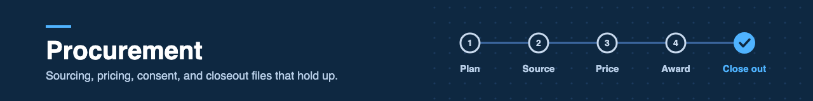

### Browser apps

*Document procurement choices and prepare records for review in your browser.*

<strong>See free browser tools (10)</strong>

<picture>
  <source media="(prefers-color-scheme: dark)" srcset="docs/readme/howto_apps_dark.png">
  
</picture>

Try an app online, or download its ZIP from Releases to use it offline. The online versions are hosted with GitHub Pages.

<table width="100%">
  <thead><tr><th width="80">&nbsp;</th><th>&nbsp;</th></tr></thead>
  <tbody>
    <tr><td>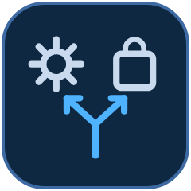</td><td><strong>Make-or-Buy Decision Worksheet</strong> Compare user-entered Make and Buy estimates, schedule and risk, then document a Program proposal and Procurement review offline. <a href="https://courtney-chapman.github.io/tools-public/apps/make-or-buy-decision/">Try online</a> · <a href="https://github.com/courtney-chapman/tools-public/releases/tag/make-or-buy-decision-v1.0.3">Download</a> · <a href="https://github.com/courtney-chapman/tools-public/blob/main/apps/make-or-buy-decision/README.md">Guide</a></td></tr>
    <tr><td></td><td><strong>Individual Subcontracting Plan Builder</strong> Prepare period goals, worksheets, and an individual small business subcontracting plan for review offline. <a href="https://courtney-chapman.github.io/tools-public/apps/individual-subcontracting-plan-builder/">Try online</a> · <a href="https://github.com/courtney-chapman/tools-public/releases/tag/individual-subcontracting-plan-builder-v1.0.3">Download</a> · <a href="https://github.com/courtney-chapman/tools-public/blob/main/apps/individual-subcontracting-plan-builder/README.md">Guide</a></td></tr>
    <tr><td></td><td><strong>Commercial Product, Service, and COTS Determination</strong> Organize sources, answer the applicable commercial definition and COTS questions, and prepare a buyer determination offline. <a href="https://courtney-chapman.github.io/tools-public/apps/commercial-item-determination/">Try online</a> · <a href="https://github.com/courtney-chapman/tools-public/releases/tag/commercial-item-determination-v1.0.3">Download</a> · <a href="https://github.com/courtney-chapman/tools-public/blob/main/apps/commercial-item-determination/README.md">Guide</a></td></tr>
    <tr><td></td><td><strong>Noncompetitive Source Justification</strong> Prepare a factual four-section justification for Procurement review in an offline browser app. <a href="https://courtney-chapman.github.io/tools-public/apps/noncompetitive-source-justification/">Try online</a> · <a href="https://github.com/courtney-chapman/tools-public/releases/tag/noncompetitive-source-justification-v1.0.3">Download</a> · <a href="https://github.com/courtney-chapman/tools-public/blob/main/apps/noncompetitive-source-justification/README.md">Guide</a></td></tr>
    <tr><td></td><td><strong>Subcontract Negotiation Memorandum</strong> Prepare, document, and review a subcontract negotiation record offline. <a href="https://courtney-chapman.github.io/tools-public/apps/subcontract-negotiation-memo/">Try online</a> · <a href="https://github.com/courtney-chapman/tools-public/releases/tag/subcontract-negotiation-memo-v1.1.3">Download</a> · <a href="https://github.com/courtney-chapman/tools-public/blob/main/apps/subcontract-negotiation-memo/README.md">Guide</a></td></tr>
    <tr><td>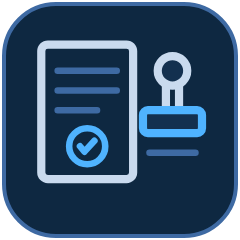</td><td><strong>Consent-to-Subcontract Package Builder</strong> Document the buyer’s consent assessment, organize supporting references, and prepare a working package for Procurement review offline. <a href="https://courtney-chapman.github.io/tools-public/apps/consent-to-subcontract/">Try online</a> · <a href="https://github.com/courtney-chapman/tools-public/releases/tag/consent-to-subcontract-v1.0.3">Download</a> · <a href="https://github.com/courtney-chapman/tools-public/blob/main/apps/consent-to-subcontract/README.md">Guide</a></td></tr>
    <tr><td>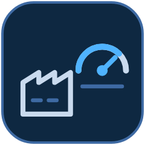</td><td><strong>Supplier Performance Evaluation</strong> Record supplier ratings, evidence, and corrective-action follow-up in an offline browser app. <a href="https://courtney-chapman.github.io/tools-public/apps/supplier-performance-evaluation/">Try online</a> · <a href="https://github.com/courtney-chapman/tools-public/releases/tag/supplier-performance-evaluation-v1.0.3">Download</a> · <a href="https://github.com/courtney-chapman/tools-public/blob/main/apps/supplier-performance-evaluation/README.md">Guide</a></td></tr>
    <tr><td>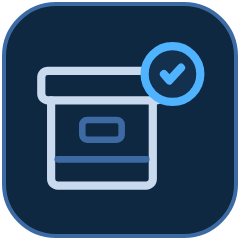</td><td><strong>Subcontract Closeout Checklist</strong> Track closeout tasks, issues, and continuing obligations, then prepare a working checklist and summary offline. <a href="https://courtney-chapman.github.io/tools-public/apps/subcontract-closeout/">Try online</a> · <a href="https://github.com/courtney-chapman/tools-public/releases/tag/subcontract-closeout-v1.0.3">Download</a> · <a href="https://github.com/courtney-chapman/tools-public/blob/main/apps/subcontract-closeout/README.md">Guide</a></td></tr>
    <tr><td>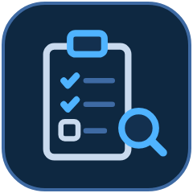</td><td><strong>Procurement File Readiness Checklist</strong> Record a human review of procurement-file records, identify corrections and open questions, and print an internal assessment offline. <a href="https://courtney-chapman.github.io/tools-public/apps/cpsr-procurement-file-checklist/">Try online</a> · <a href="https://github.com/courtney-chapman/tools-public/releases/tag/cpsr-procurement-file-checklist-v1.1.3">Download</a> · <a href="https://github.com/courtney-chapman/tools-public/blob/main/apps/cpsr-procurement-file-checklist/README.md">Guide</a></td></tr>
    <tr><td>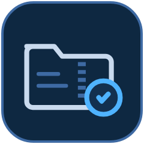</td><td><strong>Offline Audit Package Organizer</strong> Arrange file copies in an audit folder template, review what is missing, and export a ZIP with a PDF checklist. <a href="https://courtney-chapman.github.io/tools-public/apps/offline-audit-package-organizer/">Try online</a> · <a href="https://github.com/courtney-chapman/tools-public/releases/tag/offline-audit-package-organizer-v1.0.3">Download</a> · <a href="https://github.com/courtney-chapman/tools-public/blob/main/apps/offline-audit-package-organizer/README.md">Guide</a></td></tr>
  </tbody>
</table>

### AI plugins

*Use your AI assistant for focused procurement research, analysis, and drafting.*

<strong>See plugins for AI chatbots (7)</strong>

<picture>
  <source media="(prefers-color-scheme: dark)" srcset="docs/readme/howto_plugins_dark.png">
  
</picture>

**Install a plugin:** Follow the [step-by-step installation guide](docs/install-plugins.md) for ChatGPT, Codex, or Claude Code. For ChatGPT, if plugin ZIP upload is available to your account, use the **Download ZIP** link beside the plugin you want below.

| &nbsp;&nbsp;&nbsp;&nbsp;&nbsp;&nbsp;&nbsp;&nbsp;&nbsp;&nbsp;&nbsp;&nbsp;&nbsp;&nbsp; |  |
| --- | --- |
|  | **Procurement Market Research** Find suppliers, public pricing, and evidence for federal prime-contractor market research. <em>Try: “Research suppliers and public pricing for [product or service].”</em> [Download ZIP](https://github.com/courtney-chapman/tools-public/releases/download/procurement-market-research-v0.1.6/procurement-market-research.zip) · [Source](https://github.com/courtney-chapman/tools-public/tree/main/plugins/procurement-market-research) |
| 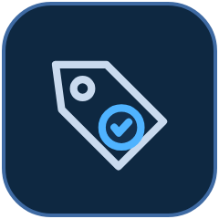 | **FAR-Compliant Commercial Item Determination** Assess commercial product, service, and COTS status under FAR 2.101. <em>Try: “Assess whether this software subscription is a commercial product or service.”</em> [Download ZIP](https://github.com/courtney-chapman/tools-public/releases/download/far-compliant-commercial-item-determination-v0.1.5/far-compliant-commercial-item-determination.zip) · [Source](https://github.com/courtney-chapman/tools-public/tree/main/plugins/far-compliant-commercial-item-determination) |
|  | **FAR-Compliant Non-Competitive Source Justification** Research suppliers, alternatives, and public prices, then draft a supported sole-source or noncompetitive justification. <em>Try: “Review this sole-source justification and identify unsupported claims.”</em> [Download ZIP](https://github.com/courtney-chapman/tools-public/releases/download/far-compliant-non-competitive-source-justification-v0.1.5/far-compliant-non-competitive-source-justification.zip) · [Source](https://github.com/courtney-chapman/tools-public/tree/main/plugins/far-compliant-non-competitive-source-justification) |
| 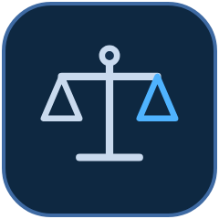 | **FAR-Compliant Price Analysis for Goods** Draft price analyses for government-funded goods using competition and market evidence. <em>Try: “Draft a price analysis from these three quotes for the same item.”</em> [Download ZIP](https://github.com/courtney-chapman/tools-public/releases/download/far-compliant-price-analysis-for-goods-v0.1.5/far-compliant-price-analysis-for-goods.zip) · [Source](https://github.com/courtney-chapman/tools-public/tree/main/plugins/far-compliant-price-analysis-for-goods) |
|  | **Commercial and Indirect Price Analysis (Lite)** Draft evidence-based price analyses for commercial and indirect purchases. <em>Try: “Compare these two consulting proposals and explain whether the selected price is reasonable.”</em> [Download ZIP](https://github.com/courtney-chapman/tools-public/releases/download/indirect-and-commercial-price-analysis-for-services-lite-v0.2.4/indirect-and-commercial-price-analysis-for-services-lite.zip) · [Source](https://github.com/courtney-chapman/tools-public/tree/main/plugins/indirect-and-commercial-price-analysis-for-services-lite) |
|  | **FAR-Compliant Price Analysis for Subcontracts (Lite)** Draft subcontract bid summaries and price analyses for awards, options, and modifications. <em>Try: “Draft a bid summary and price analysis for this subcontract award.”</em> [Download ZIP](https://github.com/courtney-chapman/tools-public/releases/download/far-compliant-price-analysis-for-subcontracts-lite-v0.2.6/far-compliant-price-analysis-for-subcontracts-lite.zip) · [Source](https://github.com/courtney-chapman/tools-public/tree/main/plugins/far-compliant-price-analysis-for-subcontracts-lite) |
|  | **Software/SaaS Negotiation Strategy** Build discovery questions and negotiation plans for SaaS buys under the Simplified Acquisition Threshold. <em>Try: “Help me prepare questions and negotiation points for this SaaS renewal.”</em> [Download ZIP](https://github.com/courtney-chapman/tools-public/releases/download/software-saas-negotiation-strategy-v0.1.5/software-saas-negotiation-strategy.zip) · [Source](https://github.com/courtney-chapman/tools-public/tree/main/plugins/software-saas-negotiation-strategy) |

---

## [Government property](#government-property)

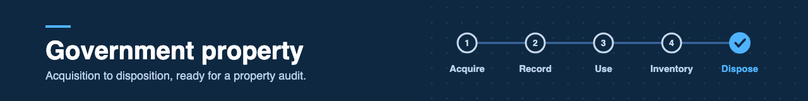

### Browser apps

*Prepare the forms and records that support government property work in your browser.*

<strong>See free browser tools (6)</strong>

<picture>
  <source media="(prefers-color-scheme: dark)" srcset="docs/readme/howto_apps_dark.png">
  
</picture>

Try an app online, or download its ZIP from Releases to use it offline. The online versions are hosted with GitHub Pages.

| &nbsp;&nbsp;&nbsp;&nbsp;&nbsp;&nbsp;&nbsp;&nbsp;&nbsp;&nbsp;&nbsp;&nbsp;&nbsp;&nbsp; |  |
| --- | --- |
|  | **DD Form 1149 Generator** Create DD Form 1149-style shipping documents and continuation sheets offline, with shipment preparation guidance. [Try online](https://courtney-chapman.github.io/tools-public/apps/dd1149-generator/) · [Download](https://github.com/courtney-chapman/tools-public/releases/tag/dd1149-generator-v1.0.6) · [Guide](https://github.com/courtney-chapman/tools-public/blob/main/apps/dd1149-generator/README.md) |
|  | **Government Property Record Template Generator** Create property snapshot and transaction-history CSV templates, review files, and compare common identifiers offline. [Try online](https://courtney-chapman.github.io/tools-public/apps/government-property-record-template-generator/) · [Download](https://github.com/courtney-chapman/tools-public/releases/tag/government-property-record-template-generator-v1.1.4) · [Guide](https://github.com/courtney-chapman/tools-public/blob/main/apps/government-property-record-template-generator/README.md) |
|  | **Government Property Custody Receipt Generator** Create printable property issuance, return, and custody acknowledgment receipts with an optional inspection checklist. [Try online](https://courtney-chapman.github.io/tools-public/apps/property-custody-receipt-generator/) · [Download](https://github.com/courtney-chapman/tools-public/releases/tag/property-custody-receipt-generator-v1.1.4) · [Guide](https://github.com/courtney-chapman/tools-public/blob/main/apps/property-custody-receipt-generator/README.md) |
|  | **Physical Inventory Count Sheet Generator** Create standard or blind count sheets, record observations, and export discrepancies. [Try online](https://courtney-chapman.github.io/tools-public/apps/physical-inventory-count-sheet-generator/) · [Download](https://github.com/courtney-chapman/tools-public/releases/tag/physical-inventory-count-sheet-generator-v1.0.4) · [Guide](https://github.com/courtney-chapman/tools-public/blob/main/apps/physical-inventory-count-sheet-generator/README.md) |
| 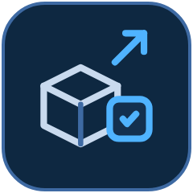 | **Government Property Disposition Preparation Checklist Generator** Organize a working property listing, checklist, and summary before disposition review. [Try online](https://courtney-chapman.github.io/tools-public/apps/government-property-disposition-preparation-generator/) · [Download](https://github.com/courtney-chapman/tools-public/releases/tag/government-property-disposition-preparation-generator-v1.0.4) · [Guide](https://github.com/courtney-chapman/tools-public/blob/main/apps/government-property-disposition-preparation-generator/README.md) |
|  | **PMSA Evidence Preparation Toolkit** Organize evidence references, review all 22 property elements, and print an overall status dashboard offline. [Try online](https://courtney-chapman.github.io/tools-public/apps/pmsa-evidence-preparation-toolkit/) · [Download](https://github.com/courtney-chapman/tools-public/releases/tag/pmsa-evidence-preparation-toolkit-v1.1.4) · [Guide](https://github.com/courtney-chapman/tools-public/blob/main/apps/pmsa-evidence-preparation-toolkit/README.md) |

### AI plugins

*Use your AI assistant to navigate government property questions and prepare supporting documentation.*

<strong>See plugins for AI chatbots (4)</strong>

<picture>
  <source media="(prefers-color-scheme: dark)" srcset="docs/readme/howto_plugins_dark.png">
  
</picture>

**Install a plugin:** Follow the [step-by-step installation guide](docs/install-plugins.md) for ChatGPT, Codex, or Claude Code. For ChatGPT, if plugin ZIP upload is available to your account, use the **Download ZIP** link beside the plugin you want below.

| &nbsp;&nbsp;&nbsp;&nbsp;&nbsp;&nbsp;&nbsp;&nbsp;&nbsp;&nbsp;&nbsp;&nbsp;&nbsp;&nbsp; |  |
| --- | --- |
| 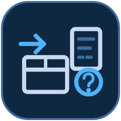 | **GFP Receipt Discrepancy Correspondence** Draft and review GFP receipt documentation requests, shipment discrepancy notices, and accountable-contract clarification requests. <em>Try: “Draft a notice about GFP received without complete shipment records.”</em> [Download ZIP](https://github.com/courtney-chapman/tools-public/releases/download/government-property-receipt-discrepancy-v0.1.3/government-property-receipt-discrepancy.zip) · [Source](https://github.com/courtney-chapman/tools-public/tree/main/plugins/government-property-receipt-discrepancy) |
| 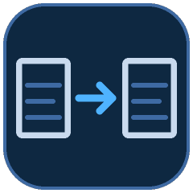 | **Government Property Contract Transfer Guide** Explain GFP transfers, CAP delivery, cross-contract use, and physical movement; prepare or review a proposed transaction. <em>Try: “Explain what approvals and records this cross-contract property transfer needs.”</em> [Download ZIP](https://github.com/courtney-chapman/tools-public/releases/download/government-property-contract-transfer-guide-v0.1.3/government-property-contract-transfer-guide.zip) · [Source](https://github.com/courtney-chapman/tools-public/tree/main/plugins/government-property-contract-transfer-guide) |
|  | **Government Property LTDD Relief Letter Generator** Draft and review LTDD relief packages, separating verified facts from assumptions and evidence gaps. <em>Try: “Review this lost-property report for missing evidence before drafting a relief request.”</em> [Download ZIP](https://github.com/courtney-chapman/tools-public/releases/download/government-property-ltdd-relief-letter-generator-v0.1.4/government-property-ltdd-relief-letter-generator.zip) · [Source](https://github.com/courtney-chapman/tools-public/tree/main/plugins/government-property-ltdd-relief-letter-generator) |
| 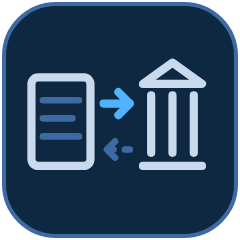 | **Government Property Written Direction Request** Draft and review requests for written Government direction on proposed property actions, conflicting instructions, and unresolved next steps. <em>Try: “Draft a request for written direction about property left after contract closeout.”</em> [Download ZIP](https://github.com/courtney-chapman/tools-public/releases/download/government-property-written-direction-request-generator-v0.1.3/government-property-written-direction-request-generator.zip) · [Source](https://github.com/courtney-chapman/tools-public/tree/main/plugins/government-property-written-direction-request-generator) |

---

## [Contracts](#contracts)

### Browser apps

*Prepare contract analysis and records for review in your browser.*

<strong>See free browser tools (1)</strong>

<picture>
  <source media="(prefers-color-scheme: dark)" srcset="docs/readme/howto_apps_dark.png">
  
</picture>

Try the app online, or download its ZIP from Releases to use it offline. The online version is hosted with GitHub Pages.

| &nbsp;&nbsp;&nbsp;&nbsp;&nbsp;&nbsp;&nbsp;&nbsp;&nbsp;&nbsp;&nbsp;&nbsp;&nbsp;&nbsp; |  |
| --- | --- |
| 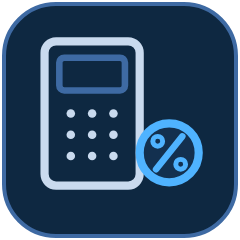 | **Weighted Guidelines Calculator** Build and review a working DoD profit objective from documented, user-selected factors in an offline browser app. [Try online](https://courtney-chapman.github.io/tools-public/apps/weighted-guidelines-calculator/) · [Download](https://github.com/courtney-chapman/tools-public/releases/tag/weighted-guidelines-calculator-v1.0.2) · [Guide](https://github.com/courtney-chapman/tools-public/blob/main/apps/weighted-guidelines-calculator/README.md) |

---

## [Finance](#finance)

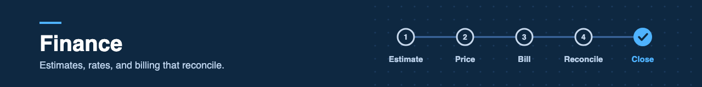

Tools for cost and pricing are coming soon.

## Support Me

**These tools are free to use.** You can [support my work on Patreon](https://www.patreon.com/courtney_chapman/posts/support-work-175991238) with a voluntary contribution.

Your contribution helps cover fixed costs such as software subscriptions and API services, as well as the time I spend building and maintaining the tools.

## Portfolio

Explore [Courtney’s portfolio](https://courtneypetersonchapman.notion.site/) for related projects and demonstrations.

## Licensing and security

These tools are free for noncommercial use. For commercial use, please contact me.

See the [security policy](https://github.com/courtney-chapman/tools-public/blob/main/SECURITY.md) to report a concern.
